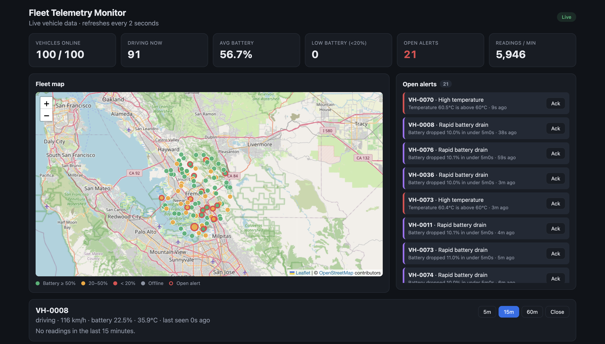
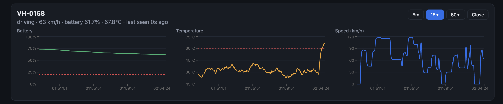
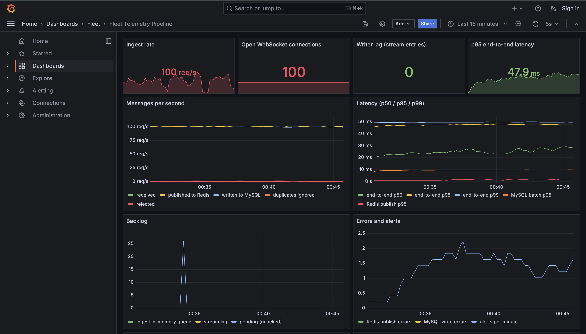
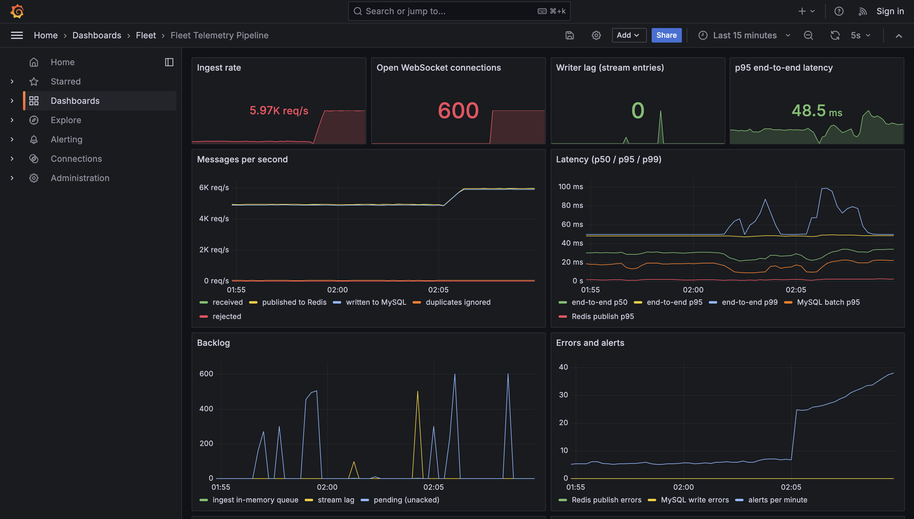
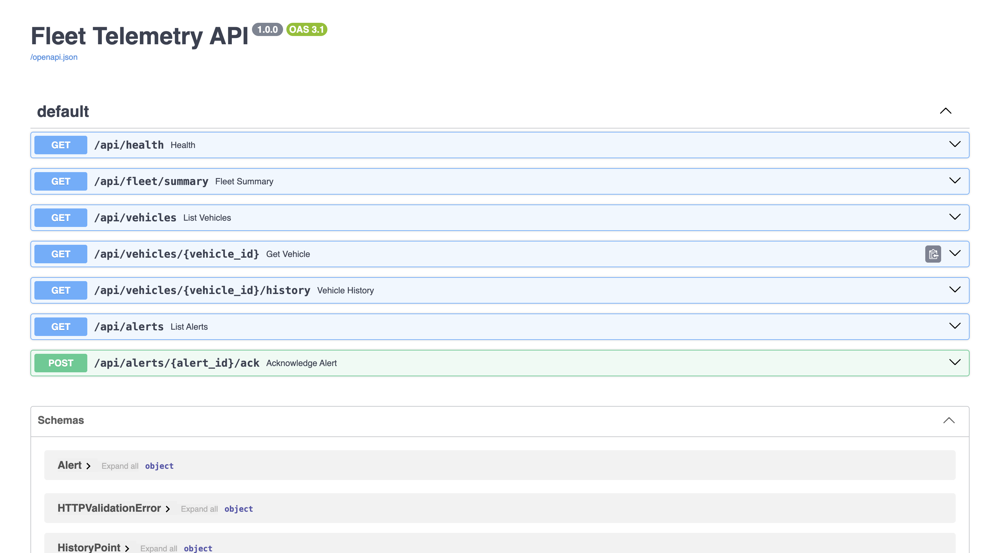
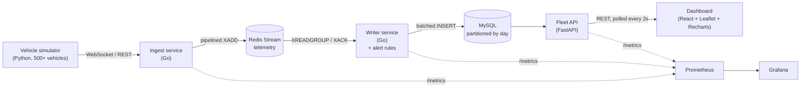

# Vehicle Telemetry Ingestion & Fleet Monitoring Platform

A real-time pipeline that collects telemetry from a fleet of electric vehicles, stores it, detects problems, and shows everything on a live dashboard.

- **Go** services ingest data over WebSockets/REST and write it to MySQL.
- **Redis Streams** sit in between as a durable buffer.
- A **FastAPI** service serves the data to a **React** dashboard with a live map, charts, and alerts.
- **Prometheus + Grafana** monitor the pipeline itself.
- **Docker Compose** starts all nine services with one command.

Measured on a 2-vCPU machine: **~5,100 messages/second sustained with zero backlog**, 98% of messages stored within 50 ms, zero data loss when the writer is killed and restarted.

## Screenshots

**Live fleet dashboard**


**Vehicle detail: battery, temperature and speed history**


**Pipeline monitoring in Grafana**


**Load test**


**Auto-generated API docs**


---

## 1. Architecture



### What happens to one message

1. **Simulator** – each simulated car sends JSON such as
   `{"vehicle_id":"VH-0042","ts":"2026-09-27T20:15:01.123Z","speed_kph":64.2,"battery_pct":71.5,"temp_c":33.1,"lat":37.54,"lng":-121.98}`
2. **Ingest (Go)** – receives it on a WebSocket, validates it (ranges, timestamp not in the future, and so on), and puts it on an in-memory queue (a Go channel). Invalid messages are rejected and the sender gets the reason back.
3. **Publishers (Go goroutines)** – take up to 500 messages at a time from the queue and write them to the Redis stream in one pipelined round trip.
4. **Writer (Go)** – reads batches from the stream as part of a *consumer group*, runs the alert rules, writes the batch to MySQL, and only then acknowledges (XACK) the messages.
5. **MySQL** – `telemetry` keeps every reading (partitioned by day), `vehicle_latest` keeps one row per car for the map, and `alerts` holds detected problems.
6. **API (FastAPI)** – serves the fleet summary, vehicle list, downsampled history, and alerts.
7. **Dashboard (React)** – polls the API every 2 seconds and draws the map, cards, charts, and alert list.

---

## 2. Tech stack

| Layer | Technology | Why |
|---|---|---|
| Ingestion | Go, gorilla/websocket | Goroutines handle thousands of concurrent connections cheaply |
| Buffer | Redis Streams | Durable, ordered log with consumer groups and acknowledgements |
| Storage | MySQL 8 | Relational model, strong indexing, and range partitioning for time-series data |
| Alerting | Go rules engine (in the writer) | Runs on the data as it flows, with no extra service |
| API | Python, FastAPI, SQLAlchemy | Fast to build, auto-generated OpenAPI docs at `/docs` |
| Frontend | React, Vite, Leaflet, Recharts | Live map and charts |
| Monitoring | Prometheus, Grafana | Throughput, latency percentiles, backlog, errors |
| Packaging | Docker, Docker Compose | One command to run the whole stack |
| CI | GitHub Actions | gofmt, vet, and tests (Go), pytest, npm build, docker build |

---

## 3. Quick start (Docker)

Prerequisite: Docker Desktop.

```bash
docker compose up --build
```

Wait about 30 seconds for MySQL to initialize, then open:

| What | URL |
|---|---|
| Dashboard | http://localhost:3000 |
| API docs (Swagger) | http://localhost:8000/docs |
| Grafana (pipeline dashboard) | http://localhost:3001 → Dashboards → Fleet → *Fleet Telemetry Pipeline* |
| Prometheus | http://localhost:9090 |
| Ingest health / metrics | http://localhost:8081/healthz, http://localhost:8081/metrics |
| Writer metrics | http://localhost:9101/metrics |

By default the simulator runs 100 vehicles at 1 reading per second. To change that:

```bash
VEHICLES=500 INTERVAL=0.5 docker compose up -d simulator
```

Stop everything with `docker compose down`. Add `-v` to also delete the stored data.

### Sending data by hand (REST)

```bash
curl -X POST localhost:8081/v1/telemetry -H 'Content-Type: application/json' -d '[
  {"vehicle_id":"TEST-1","ts":"'$(date -u +%Y-%m-%dT%H:%M:%SZ)'","speed_kph":50,"battery_pct":80,"temp_c":70,"lat":37.55,"lng":-121.99}
]'
# -> {"accepted":1,"rejected":null}   and a HIGH_TEMP alert appears on the dashboard
```

---

## 4. Running without Docker (for development)

You need Go 1.22+, Python 3.11+, Node 20+, Redis 7, and MySQL 8 running locally.

```bash
# database
mysql -uroot -e "CREATE DATABASE fleet; CREATE USER 'fleet'@'%' IDENTIFIED BY 'fleet'; GRANT ALL ON fleet.* TO 'fleet'@'%';"
mysql -uroot fleet < db/init.sql

# Go services (two terminals)
cd ingest-service && go run ./cmd/ingest
cd ingest-service && MYSQL_DSN="fleet:fleet@tcp(localhost:3306)/fleet?parseTime=true&loc=UTC&time_zone=%27%2B00%3A00%27" go run ./cmd/writer

# API
cd api && pip install -r requirements-dev.txt && uvicorn app.main:app --reload

# Dashboard (http://localhost:5173)
cd dashboard && npm install && npm run dev

# Simulator
cd simulator && pip install -r requirements.txt && python simulator.py --vehicles 50
```

### Tests

```bash
cd ingest-service && go test ./...     # validation, alert rules, partition planning, JSON decoding
cd api && pytest -q                    # endpoints (with a fake repository), status and downsampling helpers
cd dashboard && npm run build
```

Or use `make test`.

---

## 5. Project structure

```
fleet-telemetry-platform/
├── ingest-service/              Go module with two binaries
│   ├── cmd/ingest/              WebSocket + REST server -> Redis stream
│   ├── cmd/writer/              Redis consumer group -> MySQL, alerts, partitions
│   └── internal/
│       ├── telemetry/           message struct + validation (+ tests)
│       ├── alerts/              rules engine: HIGH_TEMP, LOW_BATTERY, RAPID_DRAIN (+ tests)
│       ├── store/               MySQL writes, daily partition management (+ tests)
│       ├── metrics/             tiny Prometheus exporter (counter, gauge, histogram)
│       └── config/              env-var helpers
├── api/                         FastAPI service
│   ├── app/main.py              routes, response models, request metrics
│   ├── app/repository.py        all SQL
│   ├── app/status.py            pure helpers (online/offline, downsampling)
│   └── tests/
├── dashboard/                   React app (Vite)
│   └── src/components/          SummaryCards, FleetMap, AlertsPanel, VehicleDetail, VehicleTable
├── simulator/simulator.py       fleet simulator / load generator
├── db/init.sql                  schema
├── monitoring/                  Prometheus config + Grafana datasource and dashboard
├── docker-compose.yml
└── .github/workflows/ci.yml
```

---

## 6. Data model

```sql
telemetry       (vehicle_id, ts) PRIMARY KEY, speed_kph, battery_pct, temp_c, lat, lng
                -- partitioned BY RANGE (TO_DAYS(ts)), one partition per day
vehicle_latest  vehicle_id PRIMARY KEY, latest reading     -- one row per car, powers the map
alerts          id, vehicle_id, ts, alert_type, value, message, acknowledged
```

* **`PRIMARY KEY (vehicle_id, ts)`** does two jobs. It serves the most common query ("history of car X over the last N minutes") straight from the index, and it makes duplicates impossible: the writer uses `INSERT IGNORE`, so a message delivered twice is stored once.
* **Daily partitions.** Queries on recent data only touch recent partitions (*partition pruning*). Old data is removed by `DROP PARTITION`, which is instant, instead of a huge `DELETE`. The writer creates partitions 3 days ahead and drops those older than `RETENTION_DAYS` (default 7).
* **`vehicle_latest`** is kept up to date on every batch with an upsert. The map reads 500 rows instead of scanning millions. The upsert ignores late, older messages, so the map never goes backwards.

---

## 7. Key design decisions (what to explain in an interview)

**Why put Redis between ingest and MySQL?**
It decouples receiving from storing. Traffic comes in bursts and databases slow down (index maintenance, backups, restarts). With a buffer, ingest keeps accepting data at full speed and the writer catches up. It is also what makes the zero-data-loss test below possible.

**How is data loss prevented?**
* The writer uses a Redis *consumer group*. A message stays *pending* until the writer calls `XACK`, and the writer only acknowledges after MySQL has committed the batch.
* If the writer crashes, it re-reads its pending messages on restart (`XREADGROUP ... 0`) before taking new ones (`>`).
* That means messages can occasionally be processed twice (**at-least-once delivery**). The primary key plus `INSERT IGNORE` makes the write **idempotent**, so duplicates are harmless.
* Redis runs with AOF persistence (`--appendonly yes`), so the stream survives a Redis restart.

**What if the system is overloaded?** (backpressure)
* For WebSockets, when the in-memory queue is full, the handler blocks and stops reading from the socket. TCP flow control then slows the vehicle down, so nothing is silently dropped.
* For REST, the service answers `503` right away so the client can retry, and never blocks an HTTP worker indefinitely.

**Why is ingest fast?**
Publishing uses *batching + pipelining*: up to 500 `XADD`s are sent in one network round trip instead of 500. The writer does the same for MySQL with multi-row `INSERT`s (500 rows per statement).

**Why Go for ingest and Python for the API?**
Ingest is the hot path: thousands of long-lived connections, and CPU spent on JSON. Goroutines and a compiled language fit that. The API is low-traffic CRUD where developer speed matters more, and FastAPI also generates OpenAPI docs automatically.

**How do alerts work?**
The writer keeps a small state per vehicle in memory.
* `HIGH_TEMP`: temperature > 60 °C.
* `LOW_BATTERY`: battery < 10 %.
* `RAPID_DRAIN`: a sliding 5-minute window of battery readings. If the drop from the window's maximum is more than 10 %, the alert fires.
* A 5-minute cooldown per vehicle and alert type prevents alert spam.

**How do charts stay fast over long time ranges?**
The history endpoint *downsamples in SQL*: `GROUP BY FLOOR(UNIX_TIMESTAMP(ts)/bucket)` with `AVG()`. The chart gets at most ~300 points whether you ask for 5 minutes or 7 days.

**How do you know it is healthy?**
Each service exposes `/metrics`. Grafana shows messages per second at each stage (received, published, written, duplicates, rejected), end-to-end latency p50/p95/p99, backlog (queue depth, stream lag, pending), errors, and API latency per route.

---

## 8. Load test and reliability results

Run on a 2-vCPU cloud VM with **everything on the same machine** (simulators, Go services, MySQL, Redis, API). A laptop should do better.

```bash
# one simulator process (~4,000 msg/s max for a single Python process)
python simulator.py --vehicles 500 --interval 0.1 --duration 60
# two processes for more load
python simulator.py --vehicles 300 --interval 0.1 --duration 30 &
python simulator.py --vehicles 300 --interval 0.1 --duration 30 --id-offset 300
```

| Test | Result |
|---|---|
| Sustained ingest rate (600 vehicles × 10 Hz, 30 s) | **~5,100 msg/s**, writer stream lag stayed at **0** |
| 500 vehicles × 10 Hz, 60 s | ~249,000 messages, 0 publish errors, 0 DB errors |
| End-to-end latency (vehicle timestamp → row in MySQL) | 98 % < 50 ms, 99.9 % < 100 ms, 100 % < 250 ms |
| Duplicates sent on purpose (1 %) | all ignored by `INSERT IGNORE` (counted in `writer_duplicates_ignored_total`) |
| Invalid messages sent on purpose (0.1 %) | all rejected at ingest, the sender told why |
| **Crash test**: writer stopped, 14,708 messages sent, writer restarted | **14,708 rows stored, 0 lost**, pending = 0 |
| API latency with ~400k rows | vehicle history 8 ms, alerts 5 ms, vehicle list 21 ms, fleet summary 68 ms |

Repeat the crash test yourself:
```bash
docker compose stop writer          # messages pile up in Redis
sleep 30
docker compose start writer         # watch it catch up in Grafana (stream lag -> 0)
```

---

## 9. Ideas to extend it

* Push updates to the dashboard with WebSockets or Server-Sent Events instead of polling.
* Run several writer replicas. The consumer group already splits messages between them. Just give each one a unique `CONSUMER_NAME`.
* Swap Redis Streams for Kafka when you need multi-day replay and very high throughput.
* Add authentication (API keys for vehicles, JWT for the dashboard).
* Add geofencing alerts (vehicle leaves an allowed area).
* Deploy to Kubernetes with a Horizontal Pod Autoscaler on ingest.

---

## 10. Interview questions to prepare

1. Walk me through what happens to one message end to end. *(Section 1)*
2. Why Redis Streams and not writing directly to MySQL? Why not Kafka? *(buffering; Kafka is heavier to run, but better for long retention and replay at huge scale)*
3. What delivery guarantee do you provide, and how do you handle duplicates? *(at-least-once + idempotent writes)*
4. What happens if MySQL goes down for 5 minutes? *(ingest keeps accepting, the stream grows, the writer retries without acking, then catches up)*
5. What happens if Redis goes down? *(publishers retry with backoff, the WebSocket queue fills, backpressure slows vehicles, REST returns 503)*
6. How would you scale to 1 million vehicles? *(horizontal ingest behind a load balancer, Kafka partitioned by vehicle_id, several writers, a time-series database or sharded MySQL, and aggregation instead of storing every raw reading forever)*
7. Why is the primary key `(vehicle_id, ts)` and not an auto-increment id?
8. How does partitioning help? What is partition pruning?
9. How do you make sure the map never shows an older position than it already showed? *(conditional upsert on ts)*
10. How did you measure 5,000 msg/s and the latency numbers? *(Prometheus counters and histograms, `rate()`, and `histogram_quantile()`)*
